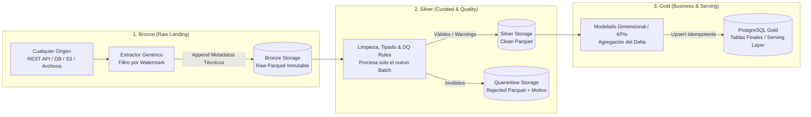

# Guía Genérica de Desarrollo Data Engineering: Pipeline Medallion con Pandas & PostgreSQL

Esta skill define el blueprint, patrones de diseño y estándares de código reutilizables para cualquier pipeline ETL/ELT implementado con **Python**, **Pandas**, almacenamiento columnar **Parquet** y **PostgreSQL** como capa de consumo.

Es aplicable a cualquier dominio (IoT, Finanzas, E-commerce, Logística, Marketing, etc.).

---

## 1. Arquitectura Medallion + Serving Relacional



### Roles de cada capa:
* **Bronze (Lakehouse Raw):** Preserva la verdad original de la fuente sin alteraciones. Almacena en **Parquet** con compresión (`snappy`) y metadatos técnicos de auditoría. Es estrictamente **Append-only**.
* **Silver (Lakehouse Curated):** Aplica tipos de datos estrictos, normalización, deduplicación y reglas de calidad sobre el lote nuevo. **Bifurca** los registros fallidos a una sub-capa de **Quarantine** para no contaminar los datos buenos sin perder trazabilidad de errores.
* **Gold (PostgreSQL Serving Layer):** Capa modelada para el negocio (modelos estrella, tablas agregadas, indicadores). Se carga mediante **Upsert idempotente** (`ON CONFLICT DO UPDATE`), permitiendo insertar registros nuevos o actualizar métricas preexistentes en milisegundos.

---

## 2. Estrategia de Carga Incremental y Control de Estado (Watermarking)

Procesar toda la historia en cada ejecución (*Full Refresh*) es ineficiente y no escala. Los pipelines deben operar de forma **incremental por deltas**:

```mermaid
flowchart TD
    subgraph Ingesta Incremental
        State[Control de Estado / Watermark<br/>Última marca procesada: T_last] --> Query[Llamada API / Origen<br/>start = T_last, end = now]
        Query --> NewBatch[batch_{uuid}.parquet]
    end

    subgraph Procesamiento Incremental
        NewBatch --> SilverRun[Notebook Silver: procesa<br/>ÚNICAMENTE el nuevo batch]
        SilverRun --> CleanBatch[clean_{uuid}.parquet]
        SilverRun --> RejectBatch[rejected_{uuid}.parquet]
    end

    subgraph Carga Incremental
        CleanBatch --> GoldAgg[Calcular KPIs/Agregados<br/>para las entidades/fechas del batch]
        GoldAgg --> UpsertPostgres[UPSERT atómico en PostgreSQL<br/>ON CONFLICT DO UPDATE]
        UpsertPostgres --> UpdateState[Actualizar Watermark en Estado: T_now]
    end
```

### Comportamiento Incremental por Capa:

1. **Bronze (Watermark Extraction):**
   * Se consulta el **Watermark** (último timestamp, ID secuencial o fecha procesada).
   * La extracción consulta a la fuente únicamente el rango comprendido entre `[watermark, now()]`.
   * El resultado se escribe como un nuevo archivo Parquet con su propio `_batch_id`. **Bronze nunca reescribe el pasado.**

2. **Silver (Batch Isolation):**
   * La notebook de Silver procesa únicamente el nuevo `batch_{uuid}.parquet` generado por la ingesta.
   * Valida la calidad de ese lote y persiste `clean_{uuid}.parquet` y/o `rejected_{uuid}.parquet`.

3. **Gold (Delta Aggregation + Upsert):**
   * Lee únicamente el lote limpio recién generado.
   * Agrupa y calcula métricas para las claves de negocio involucradas en ese lote.
   * Al ejecutar el **Upsert (`ON CONFLICT DO UPDATE`)** en PostgreSQL:
     - Si la clave (ej. `(fecha, entidad_id)`) es nueva $\rightarrow$ se **inserta**.
     - Si la clave ya existía (ej. métricas acumuladas del día) $\rightarrow$ se **actualizan** los valores en la base de datos sin duplicar.
   * Una vez confirmada la transacción, se actualiza el Watermark.

### Reprocesamiento Histórico (*Backfills*):
Si una regla de negocio o transformación cambia en el futuro, no es necesario volver a consultar las fuentes externas: basta con leer la colección histórica de Parquets inmutables en Bronze y re-ejecutar Silver y Gold.

---

## 3. Convención Universal de Particionado y Rutas

Estructura de paths estandarizada para sistemas de archivos locales, S3 o Azure Blob Storage:

```text
storage/ (o data/)
├── bronze/{domain}/{entity}/year={YYYY}/month={MM}/batch_{batch_id}.parquet
├── silver/{domain}/{entity}/year={YYYY}/month={MM}/clean_{batch_id}.parquet
└── quarantine/{domain}/{entity}/year={YYYY}/month={MM}/rejected_{batch_id}.parquet
```

### Metadatos de Linaje Obligatorios
Todo registro procesado desde Bronze en adelante debe conservar las siguientes columnas técnicas:
- `_batch_id`: Identificador único de ejecución (UUIDv4).
- `_ingested_at`: Timestamp UTC del momento exacto de captura.
- `_source_system`: Nombre del origen o conector (ej: `crm_api`, `sap_db`, `iot_devices`).

---

## 4. Templates de Código Reutilizables

Para mantener la skill concisa y modular, el código ejecutable de cada patrón se encuentra separado en archivos de plantilla listos para importar o copiar a `src/`:

| Componente | Template | Descripción |
|---|---|---|
| **Control de Estado** | [state_manager.py](./templates/state_manager.py) | Clase `StateManager` para persistir y consultar el watermark incremental en JSON/DB. |
| **Ingesta Bronze** | [bronze_writer.py](./templates/bronze_writer.py) | Inyección de columnas de linaje (`enrich_with_lineage`) y guardado Parquet particionado (`write_to_parquet_lake`). |
| **Validación Silver** | [silver_validator.py](./templates/silver_validator.py) | Evaluación vectorizada de reglas de calidad y bifurcación a `clean` y `quarantine` (`validate_and_quarantine`). |
| **Upsert Gold** | [gold_upsert.py](./templates/gold_upsert.py) | Carga idempotente y atómica en PostgreSQL con staging temporal y `ON CONFLICT DO UPDATE` (`upsert_to_postgres`). |

### Guía Rápida de Uso en Notebooks / Módulos:

#### 1. Ingesta Incremental (Bronze)
```python
from templates.state_manager import StateManager
from templates.bronze_writer import enrich_with_lineage, write_to_parquet_lake

state = StateManager()
last_mark = state.get_watermark(domain="telemetry", entity="devices")

# 1. Extraer delta desde la fuente externa
df_raw = extract_from_api(start_time=last_mark)

# 2. Agregar linaje y persistir en Bronze
df_bronze = enrich_with_lineage(df_raw, source_system="iot_hub")
write_to_parquet_lake(df_bronze, layer="bronze", domain="telemetry", entity="devices")
```

#### 2. Limpieza y Data Quality (Silver)
```python
from templates.silver_validator import validate_and_quarantine

# Reglas declarativas: True si es válido, False si viola la regla
rules = {
    "ERR_NULL_ID": df_bronze["device_id"].notnull(),
    "ERR_TEMP_OUT_OF_BOUNDS": df_bronze["temperature"].between(-40, 85),
    "ERR_INVALID_TIMESTAMP": df_bronze["event_time"].notnull()
}

df_clean, df_rejected = validate_and_quarantine(
    df=df_bronze,
    rules=rules,
    domain="telemetry",
    entity="devices"
)
```

#### 3. Modelado y Upsert Idempotente (Gold)
```python
from templates.gold_upsert import upsert_to_postgres
from templates.state_manager import StateManager

# 1. Agregaciones de negocio sobre df_clean
df_gold = df_clean.groupby(["event_date", "device_id"]).agg(
    avg_temp=("temperature", "mean"),
    total_events=("temperature", "count")
).reset_index()

# 2. Upsert en PostgreSQL
upsert_to_postgres(
    df=df_gold,
    table_name="daily_device_metrics",
    schema="gold",
    engine=db_engine,
    conflict_keys=["event_date", "device_id"]
)

# 3. Actualizar watermark
state.set_watermark(domain="telemetry", entity="devices", new_watermark=str(df_clean["event_time"].max()))
```

---

## 5. Estructura y Buenas Prácticas para Notebooks

Cuando el pipeline se organiza en Notebooks Jupyter (`.ipynb`), seguir el patrón **Notebook como Runner**:

1. **Una Notebook por Etapa y Entidad:**
   - `01_bronze_{entity}.ipynb`: Ingesta incremental por watermark y aterrizaje a Parquet.
   - `02_silver_{entity}.ipynb`: Limpieza del batch, reglas de Data Quality y guardado en Silver/Quarantine.
   - `03_gold_{entity}.ipynb`: Agregación del delta y Upsert a PostgreSQL.
2. **Notebook como Orquestador Delgado (Thin Runner):**
   - No programar lógica compleja dentro de las celdas de la notebook.
   - La lógica reutilizable (StateManager, validadores, helpers de DB) debe ubicarse en módulos `.py` (ej. en `src/`).
   - La notebook debe simplemente **importar** las funciones, pasar parámetros y mostrar tablas/gráficos interactivos para monitoreo visual.
3. **Idempotencia y Sin Estado Oculto:**
   - Debe poder ejecutarse `Kernel -> Restart & Run All` sin errores.
   - Nunca hardcodear credenciales: consumir siempre variables de entorno (`os.getenv` o `python-dotenv`).

---

## 6. Checklist para Validar Cualquier Pipeline ETL

- [ ] **Estrategia Incremental:** ¿La ingesta utiliza un watermark o ventana de tiempo en lugar de extraer toda la historia?
- [ ] **Linaje:** ¿Cada fila contiene `_batch_id`, `_ingested_at` y `_source_system`?
- [ ] **Inmutabilidad:** ¿Los datos en Bronze permanecen intactos ante reprocesamientos?
- [ ] **Quarantine:** ¿Los registros inválidos se almacenan con su lista de motivos (`_rejection_reasons`) para auditoría y KPIs de calidad?
- [ ] **Upsert:** ¿La tabla en PostgreSQL tiene definida una clave primaria / restricción única (`UNIQUE`) sobre las `conflict_keys`?
- [ ] **Idempotencia:** ¿Si ejecuto el pipeline dos veces con el mismo batch, el estado final de la base de datos es consistente y sin duplicados?
- [ ] **Desacoplamiento:** ¿Las funciones clave pueden ser importadas y testeadas con `pytest` en un pipeline de CI/CD?
