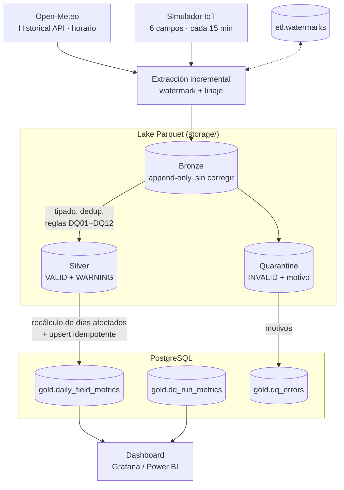
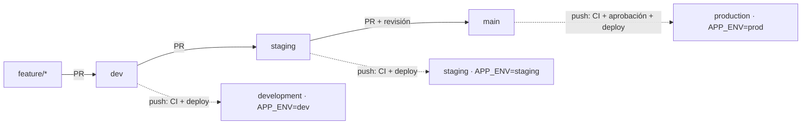

# Pipeline DataOps para calidad de datos agroclimáticos IoT

[](https://github.com/SebastianMB1/IngSoftwareETL/actions/workflows/ci.yml)


> Prueba de concepto (POC) del Proyecto Grupal de Ingeniería de Software – UADE (2026).
> Consultora: **UnaCocuCha SRL** · Cliente (ficticio): **Agropecuaria Los Tres Ombúes S.A.**
> Documento de proyecto: [`docs/TPO_Pipeline_DataOps_Documento_Final_v7.pdf`](docs/TPO_Pipeline_DataOps_Documento_Final_v7.pdf)

## Tabla de contenidos

- [Contexto](#contexto)
- [Objetivos](#objetivos)
- [Alcance](#alcance)
- [Arquitectura](#arquitectura)
- [Reglas de Data Quality](#reglas-de-data-quality)
- [Stack tecnológico](#stack-tecnológico)
- [Estructura del repositorio](#estructura-del-repositorio)
- [Instalación y ejecución](#instalación-y-ejecución)
- [Entornos: dev, staging y prod](#entornos-dev-staging-y-prod)
- [Dashboards](#dashboards)
- [Tests](#tests)
- [CI/CD](#cicd)
- [Catálogo y diccionario de datos](#catálogo-y-diccionario-de-datos)
- [Convenciones de trabajo](#convenciones-de-trabajo)
- [Equipo](#equipo)
- [Documentación](#documentación)

## Contexto

Una empresa agropecuaria tiene 6 campos (unas 18.000 ha en Buenos Aires, Santa Fe y Córdoba), con una estación IoT por campo. Cada estación mide temperatura, humedad ambiental, humedad del suelo, precipitación y viento cada 15 minutos.

Los datos llegan con faltantes, duplicados, valores fuera de rango, unidades incorrectas y períodos sin información. Alrededor del 8% de los registros tiene algún error, y eso termina en decisiones de riego y siembra tomadas con datos equivocados.

Nuestro equipo actúa como consultora de Data Engineering y DataOps. El encargo es un pipeline que ingiera, valide, transforme y monitoree esos datos, con CI/CD.

## Objetivos

**Objetivo general:** diseñar e implementar un pipeline DataOps que garantice la calidad y confiabilidad de los datos agroclimáticos IoT, automatizando su validación, transformación, monitoreo y despliegue mediante CI/CD.

**Metas medibles (SMART), verificadas en la POC:**

| Meta | Cómo se verifica en el repo |
|---|---|
| 100% de los datos en Bronze con origen y fecha de ingesta | Columnas de linaje `_batch_id`, `_ingested_at`, `_source_system` |
| Las 12 reglas detectan ≥ 95% de los errores inyectados | `tests/test_pipeline_units.py::test_reglas_detectan_al_menos_95_por_ciento_de_errores_inyectados` |
| 100% de rechazos en quarantine con motivo; Gold sin inválidos | `_rejection_reasons` en quarantine; `test_gold_no_contiene_registros_invalidos` |
| ≥ 12 tests de reglas y ≥ 80% de cobertura en validación | `tests/test_rules.py`; el CI falla si la cobertura de `src/validation` baja de 80% |
| 100% de los cambios a `main` pasan por GitHub Actions | `.github/workflows/ci.yml` + *branch protection* (ver [CI/CD](#cicd)) |
| DQ Score por campo y día; dashboard solo sobre Gold | `gold.daily_field_metrics.porcentaje_calidad`, `gold.dq_run_metrics.dq_score`, usuario `dashboard` de solo lectura |
| Corrida de un día de datos en < 5 minutos | El pipeline informa la duración al terminar (≈ 20 s en local) |

## Alcance

**Incluido:** ingesta desde Open-Meteo Historical Weather API y simulador de sensores IoT; almacenamiento raw; validación, clasificación y quarantine; métricas de calidad; CI/CD; dataset final para dashboards.

**Fuera de alcance:** aplicación móvil, control físico de sensores, automatización de maquinaria, predicción con Machine Learning, alta disponibilidad, integración con todos los sistemas del cliente y gestión formal de incidentes de calidad.

## Arquitectura



| Capa | Dónde | Contenido |
|---|---|---|
| **Bronze** | `storage/bronze/agro/{fuente}/…/batch_{id}.parquet` | Datos tal como llegaron: `timestamp` (texto crudo), `field_id`, coordenadas, las 5 variables con su unidad, `source` y linaje. Nunca se modifica. |
| **Silver** | `storage/silver/agro/measurements/…/clean_{id}.parquet` | Registros tipados (timestamp UTC) clasificados `VALID` o `WARNING`, con `_dq_warnings`. |
| **Quarantine** | `storage/quarantine/agro/measurements/…/rejected_{id}.parquet` | Registros `INVALID` sin modificar, con `_rejection_reasons` (ej. `DQ05;DQ07`). |
| **Gold** | PostgreSQL, esquema `gold` | Indicadores diarios por campo y fuente, métricas de cada corrida y registro de errores. |

**Incremental:** cada corrida trae solo la ventana `(watermark, ahora]` de cada fuente. Gold recalcula con todo Silver los días y campos afectados, así que un día que llega en varios lotes queda correcto.

**Reproceso:** si cambia una regla, `python -m src.main --reprocess <batch_id>` regenera Silver, Quarantine y Gold desde Bronze, sin volver a llamar a la API.

**Data Quality Score** = (VALID + WARNING) / total × 100. Las decisiones de diseño están en [`docs/decisiones.md`](docs/decisiones.md).

## Reglas de Data Quality

Los umbrales están en [`config/rules.yaml`](config/rules.yaml), versionados en Git. Cambiar un rango no requiere tocar código (RNF06).

| ID | Regla | Tipo | Criticidad | Criterio | Acción |
|---|---|---|---|---|---|
| DQ01 | `timestamp` obligatorio | Completitud | Crítica | No nulo ni vacío | Rechazar |
| DQ02 | `field_id` obligatorio | Completitud | Crítica | No nulo ni vacío | Rechazar |
| DQ03 | Timestamp con formato válido | Consistencia | Crítica | ISO 8601; no futuro (tolerancia 10 min); posterior a 2000 | Rechazar |
| DQ04 | Campo existente | Integridad | Crítica | `field_id` en `config/fields.yaml` (C01–C06) | Rechazar |
| DQ05 | Sin duplicados | Unicidad | Crítica | Clave `(source, field_id, timestamp)`, también contra lotes anteriores; se conserva el primero | Rechazar |
| DQ06 | Unidades esperadas | Consistencia | Crítica | °C · % · m³/m³ · mm · km/h | Rechazar |
| DQ07 | Humedad ambiental | Validez | Alta | 0 ≤ humedad ≤ 100 | Rechazar |
| DQ08 | Precipitación | Validez | Alta | ≥ 0 mm | Rechazar |
| DQ09 | Temperatura | Validez | Alta | Rechazo fuera de −40 a 60 °C; warning fuera de −15 a 45 °C | Rechazar / Warning |
| DQ10 | Humedad del suelo | Validez | Alta | Rechazo fuera de 0 a 1 m³/m³; warning fuera de 0,02 a 0,60 | Rechazar / Warning |
| DQ11 | Sin períodos sin datos | Completitud | Media | Hueco ≥ 30 min (IoT) o ≥ 120 min (Open-Meteo) por campo y variable | Warning |
| DQ12 | Sin cambios anormales | Anomalía | Media | Temperatura > 8 °C/h · humedad > 40 pts/h · suelo > 0,15 m³/m³ por hora | Warning |

## Stack tecnológico

| Componente | Tecnología |
|---|---|
| Fuente meteorológica | Open-Meteo Historical Weather API |
| Lenguaje y procesamiento | Python 3.11 · Pandas · PyArrow (Parquet) |
| Base de datos | PostgreSQL 16 (SQLAlchemy 2 + psycopg 3) |
| Data Quality | Motor propio de reglas (`src/validation`) + Pytest |
| CI/CD | GitHub Actions |
| Contenedores | Docker · Docker Compose |
| Dashboard | Grafana / Power BI (solo lectura sobre `gold`) |
| Gestión | ClickUp (Kanban) · GitHub |
| Orquestación | Apache Airflow *(opcional, no incluido en la POC)* |

## Estructura del repositorio

```
.
├── .agents/skills/            # Skills del agente: de-developer y data-governance
├── .github/workflows/ci.yml   # Lint + validación de reglas + tests + build Docker
├── catalog/                   # Catálogo de datasets en YAML (skill data-governance)
├── config/
│   ├── rules.yaml             # Reglas DQ01–DQ12 y umbrales
│   ├── fields.yaml            # Campos del cliente (C01–C06)
│   ├── pipeline.yaml          # Fuentes, ventanas, zona horaria, rutas (base de todos los entornos)
│   └── environments/          # dev.yaml, staging.yaml, prod.yaml: lo que cambia en cada entorno
├── data/                      # Datos manuales para tests (no se versionan datos reales)
├── grafana/                   # Dashboard provisionado (fuente de datos + calidad-datos.json)
├── docs/
│   ├── TPO_Pipeline_DataOps_Documento_Final_v7.{docx,pdf}
│   ├── arquitectura.excalidraw
│   ├── data_dictionary/       # Diccionario de datos por capa (generado)
│   ├── decisiones.md          # Registro de decisiones técnicas
│   ├── cambios_documento_v7.md
│   └── kanban/                # Capturas semanales del tablero
├── notebooks/                 # Runners delgados por etapa: 01_bronze, 02_silver, 03_gold
├── sql/                       # Crea agro_dev / agro_staging / agro_prod, esquema (schema/) y usuarios
├── src/
│   ├── main.py                # Punto de entrada (python -m src.main)
│   ├── pipeline.py            # Etapas run_bronze / run_silver / run_gold
│   ├── config.py              # Carga de config/*.yaml y .env
│   ├── common/                # Lake Parquet, conexión y upsert, watermarks
│   ├── ingestion/             # Open-Meteo y simulador IoT
│   ├── validation/            # Motor de reglas DQ01–DQ12 y chequeo de rules.yaml
│   ├── transformation/        # Gold: indicadores diarios
│   ├── metrics/               # DQ Score, dq_run_metrics y dq_errors
│   └── governance/            # Catalogación de datasets
├── storage/                   # Lake Parquet generado (ignorado por Git)
├── tests/                     # Pytest: reglas, pipeline e integración con PostgreSQL
├── Dockerfile
├── docker-compose.yml
├── requirements.txt / requirements-dev.txt
└── .env.example
```

## Instalación y ejecución

### Requisitos

- Python 3.11+
- Docker Desktop (Docker Compose)
- Git

### Pasos

```bash
# 1. Clonar el repositorio
git clone https://github.com/SebastianMB1/IngSoftwareETL.git
cd IngSoftwareETL

# 2. Variables de entorno: no hace falta nada, el código y Docker usan .env.example.
#    Para usar contraseñas propias: cp .env.example .env y editarlo (.env pisa a .env.example y no se sube a Git)

# 3. Levantar todo: PostgreSQL + pipeline programado en DEV, STAGING y PROD (cada 15 min) + dashboards
docker compose up -d
# Dashboards: http://localhost:3000 (se ven sin login; admin / GRAFANA_ADMIN_PASSWORD para editar)

# 4. Instalar dependencias en un entorno virtual
python -m venv .venv
source .venv/bin/activate        # Windows: .venv\Scripts\activate
pip install -r requirements-dev.txt

# 5. Ejecutar el pipeline (corrida incremental de ambas fuentes)
python -m src.main

# 6. Ejecutar los tests
pytest
```

Otras formas de correrlo:

```bash
python -m src.main --env staging              # elegir entorno: dev (defecto), staging o prod
python -m src.main --source iot_simulator     # una sola fuente (no necesita internet)
python -m src.main --reprocess <batch_id>     # regenerar Silver y Gold de un lote desde Bronze
docker compose --profile run run --rm pipeline  # el pipeline completo dentro de Docker
```

Para correr las etapas por separado y explorar los datos están las notebooks de `notebooks/`.

> **Seguridad (RNF07):** nunca subir credenciales. `.env` está en `.gitignore`. En el pipeline de CI se usan GitHub Secrets, y el pipeline se conecta con un usuario de permisos mínimos.
>
> **Windows + OneDrive:** si la ruta del repo es muy larga, los archivos del lake pueden superar el límite de 260 caracteres. En ese caso, apuntar `STORAGE_PATH` a una ruta corta (ej. `C:\agro-storage`).

## Entornos: dev, staging y prod

El mismo código corre en tres entornos aislados. Cada uno tiene su propia base, su propio lake y su propio *scheduler*:

| Entorno | Para qué | Base | Lake | Configuración |
|---|---|---|---|---|
| **DEV** | Probar código y reglas nuevas | `agro_dev` | `storage/dev/` | Solo simulador IoT, 20% de errores inyectados (para ejercitar todas las reglas) |
| **STAGING** | Ensayo general antes de producción | `agro_staging` | `storage/staging/` | Igual que PROD (ambas fuentes), con datos propios |
| **PROD** | Lo que consume el cliente | `agro_prod` | `storage/prod/` | Configuración base ([`config/pipeline.yaml`](config/pipeline.yaml)) |

- Lo que cambia por entorno está en [`config/environments/`](config/environments/) y se superpone a `config/pipeline.yaml`. Las **reglas de calidad son las mismas** en los tres.
- El entorno se elige con `APP_ENV` (o `--env`). Por defecto es **dev**, así nunca se escribe en producción por accidente.
- En Grafana, el selector **Entorno** (arriba a la izquierda) cambia los tres dashboards entre DEV, STAGING y PROD.

**Ramas y despliegue** ([`.github/workflows/deploy.yml`](.github/workflows/deploy.yml)). Cada rama es un entorno, y los cambios avanzan por PR:



Cada push a `dev`, `staging` o `main` corre el CI completo, publica la imagen `ghcr.io/sebastianmb1/ingsoftwareetl:<entorno>` y ejecuta el paso **Deploy**. Mientras no haya servidor (la POC corre local), ese paso solo informa la imagen publicada. Para que un entorno local use la imagen publicada: `PROD_IMAGE=ghcr.io/sebastianmb1/ingsoftwareetl:prod docker compose up -d scheduler-prod`.

**Configuración pendiente en GitHub** (Settings → Environments):
- En `production`, activar *Required reviewers* para que el deploy a producción pida aprobación.
- Cuando haya hosting, cargar en cada entorno los secrets `DEPLOY_HOST`, `DEPLOY_USER` y `DEPLOY_SSH_KEY`: el paso Deploy pasa a desplegar solo, por SSH, con `docker compose`.
- En Settings → Branches, proteger `main` (y conviene también `staging`) con PR obligatorio y los checks del CI.

## Dashboards

Con `docker compose up -d`, Grafana queda en **http://localhost:3000** con tres dashboards enlazados entre sí (botones arriba a la derecha) y el selector de **Entorno**. El primero es *Calidad de datos agroclimáticos* ([`grafana/dashboards/calidad-datos.json`](grafana/dashboards/calidad-datos.json)). Lee solo tablas de `gold`, con el usuario de solo lectura `dashboard`.

| Sección | Qué muestra |
|---|---|
| Última corrida | DQ Score, registros procesados, VALID / WARNING / INVALID y hace cuánto corrió |
| Evolución de la calidad | DQ Score por corrida (meta 95%) y hallazgos por regla DQ01–DQ12 |
| Clima por campo | Temperatura y humedad del suelo diarias por campo, mapa de los 6 campos (tamaño = lluvia, color = calidad) y lluvia acumulada |
| Calidad por campo y día | % de calidad por campo y día, y los últimos registros rechazados con su regla |

Un segundo dashboard, **Flujo del ETL (Bronze · Silver · Gold)** ([`grafana/dashboards/flujo-etl.json`](grafana/dashboards/flujo-etl.json)), muestra cómo se mueve cada lote por las capas. Los dos dashboards están enlazados entre sí (botón arriba a la derecha).

| Sección | Qué muestra |
|---|---|
| Recorrido de los datos | Diagrama Fuentes → Bronze → Reglas DQ → Silver / Quarantine → Gold → Dashboards, con la cantidad de registros de cada etapa en el período |
| ¿Qué hace cada capa? | Dónde vive cada capa, qué pasa en ella y su regla principal |
| Lote a lote | Cómo se reparte cada lote entre Silver y Quarantine, cuánto tarda cada etapa, las ventanas incrementales por fuente y el historial de lotes |

El tercero, **ETL paso a paso** ([`grafana/dashboards/etl-paso-a-paso.json`](grafana/dashboards/etl-paso-a-paso.json)), sigue **un registro real** por las 5 etapas. Con el selector **Registro** se elige uno válido, uno con warning o uno rechazado de los últimos lotes:

| Paso | Qué se ve |
|---|---|
| Camino del registro | Diagrama con las etapas que recorrió en color y las que no le tocaron en gris |
| 1 · Extracción | Cómo llegó de la fuente: timestamp como texto y cada valor con su unidad |
| 2 · Bronze | El archivo Parquet donde quedó y su linaje, sin ningún cambio |
| 3 · Validación | Las 12 reglas con ✔ Cumple / ⚠ Warning / ✖ Rechaza y el detalle |
| 4 · Silver o Quarantine | A dónde fue: tipado en Silver, o sin tocar y con el motivo en Quarantine |
| 5 · Gold | El indicador diario al que aportó, o por qué nunca llegó |

Las muestras salen de `gold.etl_trace` y `gold.etl_trace_steps` (unos pocos registros por lote, priorizando variedad). Las métricas por capa salen de `gold.pipeline_layer_metrics`, donde cada etapa registra cuántos registros procesó, cuánto tardó y qué ventana pidió a la fuente.

Los filtros de arriba eligen la **fuente** (Open-Meteo o Simulador IoT) y los **campos**. El servicio `scheduler` corre el pipeline cada `PIPELINE_INTERVAL_SECONDS` (15 min por defecto), así que el tablero se actualiza solo.

Colores: un color fijo por campo (paleta validada para daltonismo) y verde / amarillo / rojo solo para estados de calidad, siempre acompañados de un texto o un ícono.

## Tests

```bash
pytest                                   # unitarios (los de integración se saltean)
pytest --cov=src --cov-report=term-missing
TEST_DATABASE_URL=postgresql+psycopg://pipeline:<pass>@localhost:5432/agro_dev pytest -m db   # integración
```

- `tests/test_rules.py`: al menos un test por regla DQ01–DQ12, con los bordes de cada rango.
- `tests/test_pipeline_units.py`: simulador (detección ≥ 95%), lake append-only, Gold recalculado, DQ Score, upsert.
- `tests/test_integration_db.py`: corrida completa contra PostgreSQL, idempotencia del reproceso y Gold sin inválidos.

## CI/CD

Cada push a `main` y cada pull request ejecutan [`.github/workflows/ci.yml`](.github/workflows/ci.yml):

1. Instalación de dependencias
2. Lint (`ruff check`)
3. Validación de `config/rules.yaml` y de las notebooks
4. Tests con PostgreSQL de servicio, más cobertura mínima de 80% en `src/validation`
5. Build de la imagen Docker

**Pendiente (configuración en GitHub):** activar *branch protection* en `main` (Settings → Branches), con PR obligatorio, una aprobación y los checks `lint` y `test` en verde. Sin eso no se cumple la meta "100% de los cambios pasan por CI".

## Catálogo y diccionario de datos

Cada dataset (Bronze, Silver, Quarantine y las tablas de Gold) está catalogado siguiendo la skill `data-governance`:

- [`catalog/`](catalog/): esquema técnico y descripciones en YAML.
- [`docs/data_dictionary/`](docs/data_dictionary/): diccionario legible en Markdown.

Para regenerarlos después de cambiar un dataset: `python -m src.governance.catalog`. Las descripciones existentes se conservan.

## Convenciones de trabajo

- Ramas por funcionalidad (`feature/nombre`) y pull request con revisión cruzada antes de integrar a `main`.
- Commits descriptivos que referencien el requerimiento (`RF03: …`) cuando corresponda.
- Una tarjeta del Kanban pasa a *Completado* solo con el PR aprobado.
- Tablero Kanban (ClickUp): <!-- TODO: link al tablero --> · capturas semanales en [`docs/kanban/`](docs/kanban/).
- Decisiones técnicas: [`docs/decisiones.md`](docs/decisiones.md).

## Equipo

| Integrante | Rol |
|---|---|
| Kiara Pisera | Project Manager |
| Sebastian Martinez Benega | Data Engineer |
| Joaquin Maver | QA / Data Quality |
| Matias Posse Presa | DevOps / CI-CD |

**Materia:** Ingeniería de Software – UADE · **Docente:** <!-- TODO --> · **Entrega final:** 10 de noviembre de 2026

## Documentación

- Documento de proyecto v7: [PDF](docs/TPO_Pipeline_DataOps_Documento_Final_v7.pdf) · [DOCX](docs/TPO_Pipeline_DataOps_Documento_Final_v7.docx)
- Cambios sugeridos para la v8: [`docs/cambios_documento_v7.md`](docs/cambios_documento_v7.md)
- Diagrama de arquitectura: [`docs/arquitectura.excalidraw`](docs/arquitectura.excalidraw)
- Presentación final: <!-- TODO: link -->
- Demo / video: <!-- TODO: link -->

## Licencia

Proyecto académico, de uso exclusivamente educativo.
