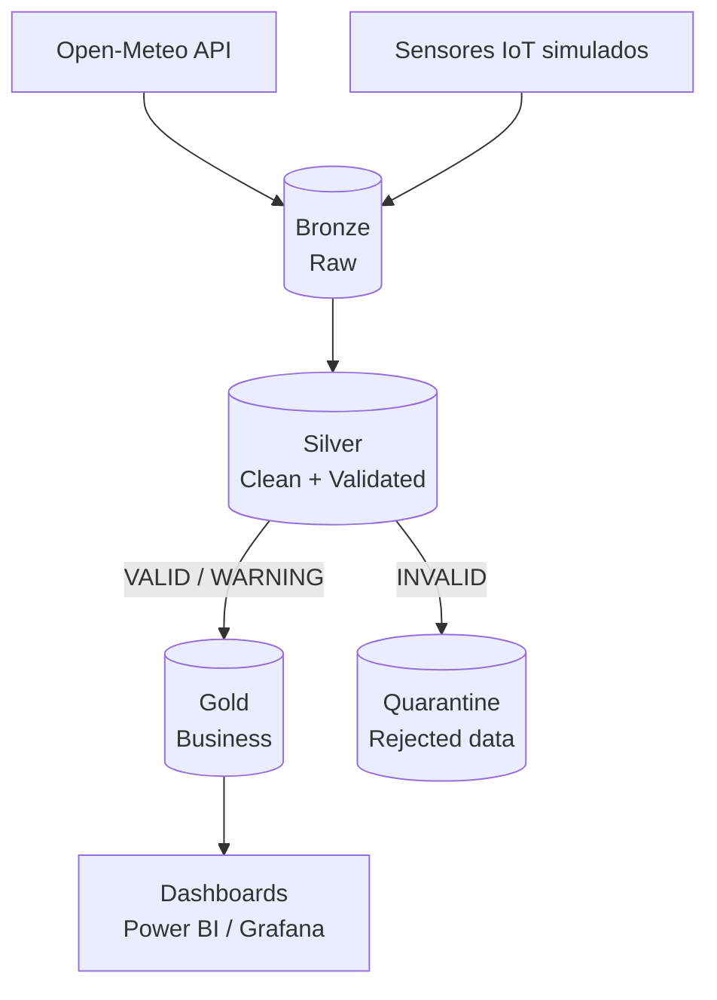

# Pipeline DataOps para calidad de datos agroclimáticos IoT


> Prueba de concepto (POC) desarrollada para el Proyecto Grupal de Ingeniería de Software – UADE (2026).

## Tabla de contenidos

- [Contexto](#contexto)
- [Problema](#problema)
- [Objetivos](#objetivos)
- [Alcance](#alcance)
- [Arquitectura Medallion](#arquitectura-medallion)
- [Reglas de Data Quality](#reglas-de-data-quality)
- [Stack tecnológico](#stack-tecnológico)
- [Estructura del repositorio](#estructura-del-repositorio)
- [Instalación y ejecución](#instalación-y-ejecución)
- [CI/CD](#cicd)
- [Convenciones de trabajo](#convenciones-de-trabajo)
- [Equipo](#equipo)
- [Documentación](#documentación)

## Contexto

Una empresa agropecuaria de gran escala posee múltiples campos equipados con sensores IoT que miden temperatura, humedad del suelo, precipitaciones, humedad ambiental y condiciones meteorológicas.

Nuestro equipo actúa como **consultora especializada en Data Engineering y DataOps**, contratada para diseñar e implementar un proceso que automatice la ingesta, validación, transformación y monitoreo de esos datos, incorporando prácticas de CI/CD.

## Problema

Los datos presentan problemas de calidad que afectan la confiabilidad de los dashboards de la organización:

- Valores faltantes
- Registros duplicados
- Mediciones fuera de rango
- Inconsistencias
- Períodos sin información

## Objetivos

**Objetivo general:** diseñar e implementar un pipeline DataOps que garantice la calidad y confiabilidad de los datos agroclimáticos provenientes de dispositivos IoT, automatizando su validación, transformación, monitoreo y despliegue mediante CI/CD.

**Objetivos específicos:**

- Centralizar los datos provenientes de distintas fuentes.
- Detectar automáticamente problemas de calidad.
- Clasificar y registrar los errores encontrados.
- Separar datos válidos de datos rechazados.
- Automatizar las validaciones mediante tests.
- Implementar un esquema de procesamiento Medallion.
- Automatizar el pipeline mediante CI/CD.
- Generar métricas de calidad.
- Permitir que los dashboards consuman únicamente datos validados.

## Alcance

**Incluido**

| Área | Detalle |
|---|---|
| Ingesta | Open-Meteo Historical Weather API, simulación de sensores IoT, ingesta periódica |
| Procesamiento | Almacenamiento raw, limpieza y transformación, validación, detección de anomalías, clasificación de registros |
| Data Quality | Reglas de calidad, ejecución automática, registro de errores, métricas |
| DataOps / CI-CD | Repositorio Git, tests automatizados, pipeline CI/CD, control de versiones, deploy del pipeline |
| Consumo | Dataset final para dashboards e indicadores de calidad |

**Fuera de alcance**

- Aplicación móvil
- Control físico de sensores IoT
- Automatización de maquinaria agrícola
- Predicción de cosechas con Machine Learning
- Sistema productivo de alta disponibilidad
- Integración con todos los sistemas reales de la organización
- Gestión de procesos y operaciones de calidad de datos (incidentes, cambios y problemas)

## Arquitectura Medallion



| Capa | Contenido | Objetivo |
|---|---|---|
| **Bronze** | Datos tal como fueron recibidos: `timestamp`, `field_id`, `latitude`, `longitude`, `temperature`, `humidity`, `soil_moisture`, `precipitation`, `wind_speed`, `source`. Sin correcciones. | Conservar la fuente original y permitir reprocesar |
| **Silver** | Ejecución de reglas de calidad. Cada registro se clasifica como `VALID`, `INVALID` o `WARNING`. Los inválidos van a quarantine. | Aplicar Data Quality sin contaminar los datos buenos |
| **Gold** | Datos agregados por campo y fecha: temperatura promedio, precipitación total, humedad de suelo y ambiental promedio, cantidad de mediciones, porcentaje de calidad. | Capa que consumen los dashboards |

**Data Quality Score** = registros válidos / registros totales × 100

## Reglas de Data Quality

| Regla | Tipo | Acción |
|---|---|---|
| `timestamp` obligatorio | Completitud | Rechazar |
| `field_id` obligatorio | Completitud | Rechazar |
| Sin registros duplicados | Unicidad | Rechazar |
| Temperatura dentro de rango definido | Validez | Rechazar / Warning |
| Humedad entre 0% y 100% | Validez | Rechazar |
| Humedad del suelo dentro de rango | Validez | Warning / Rechazar |
| Precipitación ≥ 0 | Validez | Rechazar |
| Timestamp con formato válido | Consistencia | Rechazar |
| Sin períodos inesperados sin datos | Completitud | Warning |
| La medición pertenece a un campo existente | Integridad | Rechazar |
| Unidades esperadas | Consistencia | Rechazar |
| Sin cambios anormales entre mediciones consecutivas | Anomalía | Warning |

> Los rangos exactos se definen en el archivo de configuración de reglas (`config/`), versionado junto al código. <!-- TODO: completar link al archivo de reglas -->

## Stack tecnológico

| Componente | Tecnología |
|---|---|
| Fuente meteorológica | Open-Meteo Historical Weather API |
| Lenguaje | Python |
| Procesamiento | Pandas / Polars |
| Base de datos | PostgreSQL |
| Data Quality | Great Expectations o tests propios con Pytest |
| Versionado | Git + GitHub |
| CI/CD | GitHub Actions |
| Orquestación | Apache Airflow *(opcional)* |
| Dashboard | Power BI / Grafana |
| Contenedores | Docker |

## Estructura del repositorio

> Estructura sugerida; ajustar a medida que avance el desarrollo.

```
.
├── .github/
│   └── workflows/        # Pipeline CI/CD (GitHub Actions)
├── config/               # Reglas de calidad y parámetros
├── data/                 # Datos de ejemplo (no versionar datos reales)
├── docs/                 # Documento de proyecto, diagramas, evidencia del Kanban
├── sql/                  # Scripts de creación de tablas (bronze, silver, gold)
├── src/
│   ├── ingestion/        # Ingesta desde Open-Meteo y simulador de sensores
│   ├── validation/       # Reglas de Data Quality
│   ├── transformation/   # Bronze → Silver → Gold
│   └── metrics/          # Data Quality Score y métricas
├── tests/                # Tests automatizados (Pytest)
├── docker-compose.yml
├── requirements.txt
└── README.md
```

## Instalación y ejecución

<!-- TODO: validar los comandos una vez que exista el código -->

### Requisitos

- Python 3.11+
- Docker y Docker Compose
- Git

### Pasos

```bash
# 1. Clonar el repositorio
git clone <URL_DEL_REPOSITORIO>
cd <NOMBRE_DEL_REPOSITORIO>

# 2. Configurar variables de entorno
cp .env.example .env

# 3. Levantar PostgreSQL
docker compose up -d

# 4. Instalar dependencias
pip install -r requirements.txt

# 5. Ejecutar el pipeline
python -m src.main

# 6. Ejecutar los tests
pytest
```

> Nunca subir credenciales al repositorio: usar `.env` (ignorado por Git) y GitHub Secrets para el pipeline.

## CI/CD

Cada push o pull request ejecuta automáticamente:

1. Instalación de dependencias
2. Análisis de estilo del código (lint)
3. Tests automatizados (Pytest)
4. Validación de las reglas de calidad
5. Build de la imagen Docker

<!-- TODO: agregar badge de estado del workflow y describir el paso de deploy -->

## Convenciones de trabajo

- Ramas por funcionalidad (`feature/nombre`) y pull request con revisión cruzada antes de integrar a `main`.
- Commits descriptivos, referenciando el requerimiento (`RFxx`) cuando corresponda.
- Tablero Kanban: <!-- TODO: link al tablero (Trello / Jira / Miro) -->
- Registro de decisiones: <!-- TODO: link a la bitácora o actas -->

## Equipo

| Integrante | Rol |
|---|---|
| <!-- TODO --> | Project Manager |
| <!-- TODO --> | Data Engineer |
| <!-- TODO --> | QA / Data Quality |
| <!-- TODO --> | DevOps / CI-CD |

**Materia:** Ingeniería de Software – UADE · **Docente:** <!-- TODO --> · **Entrega final:** 10 de noviembre de 2026

## Documentación

- Documento de proyecto: `docs/` <!-- TODO: link -->
- Presentación final: <!-- TODO: link -->
- Demo / video: <!-- TODO: link -->

## Licencia

Proyecto académico. <!-- TODO: definir licencia (por ejemplo, MIT) o indicar uso exclusivamente académico -->
