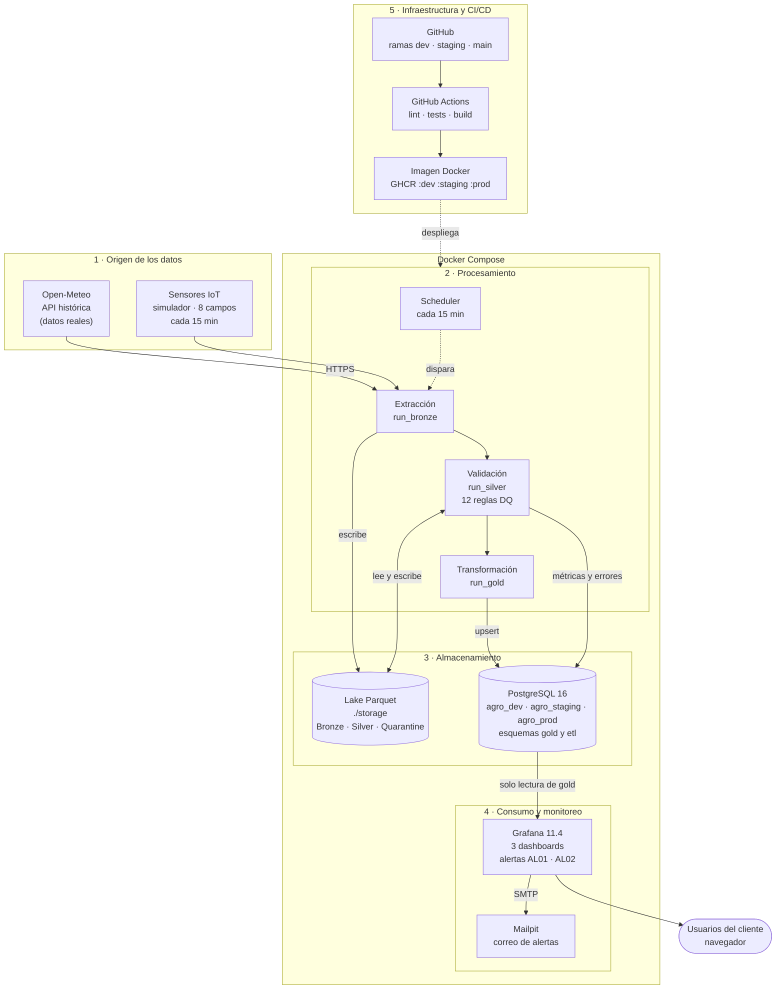
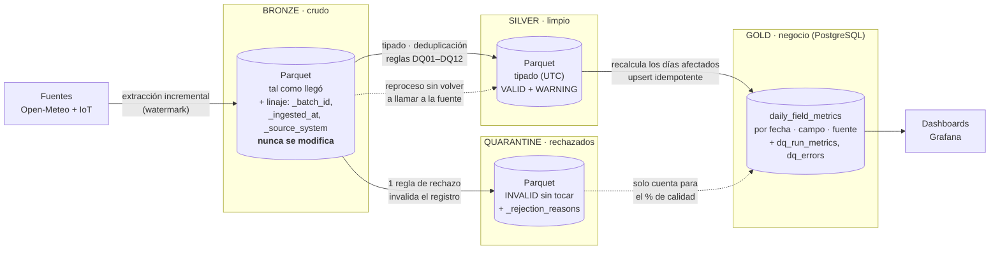
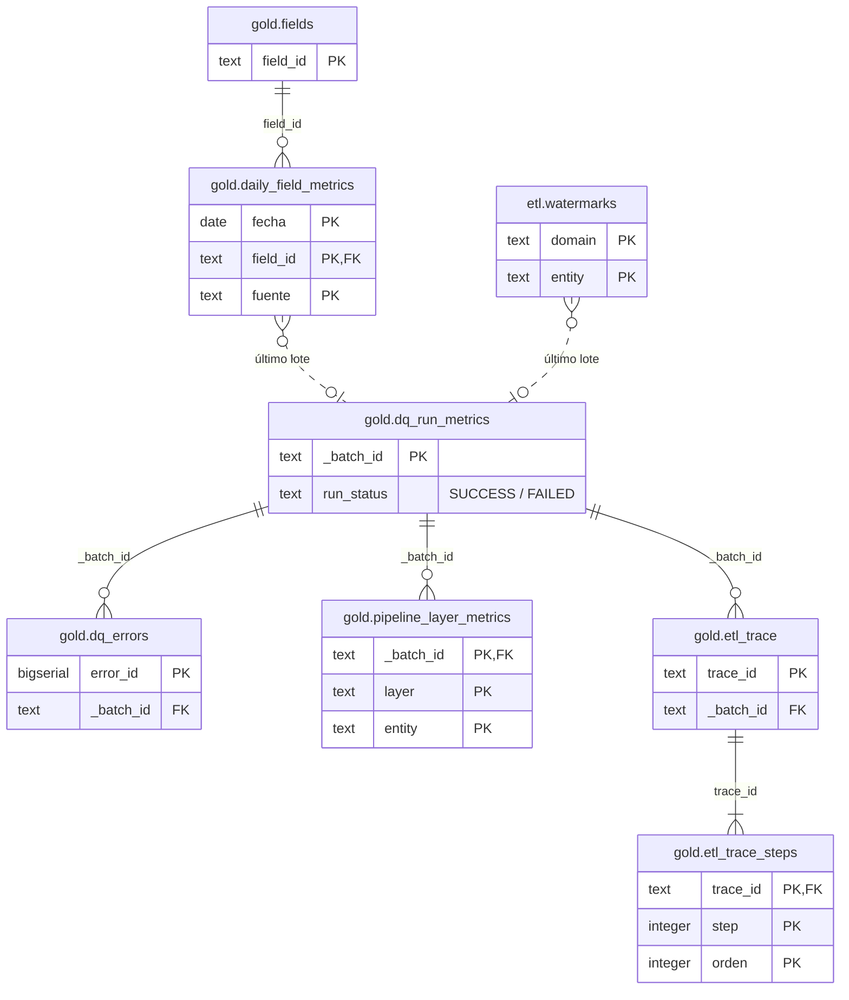
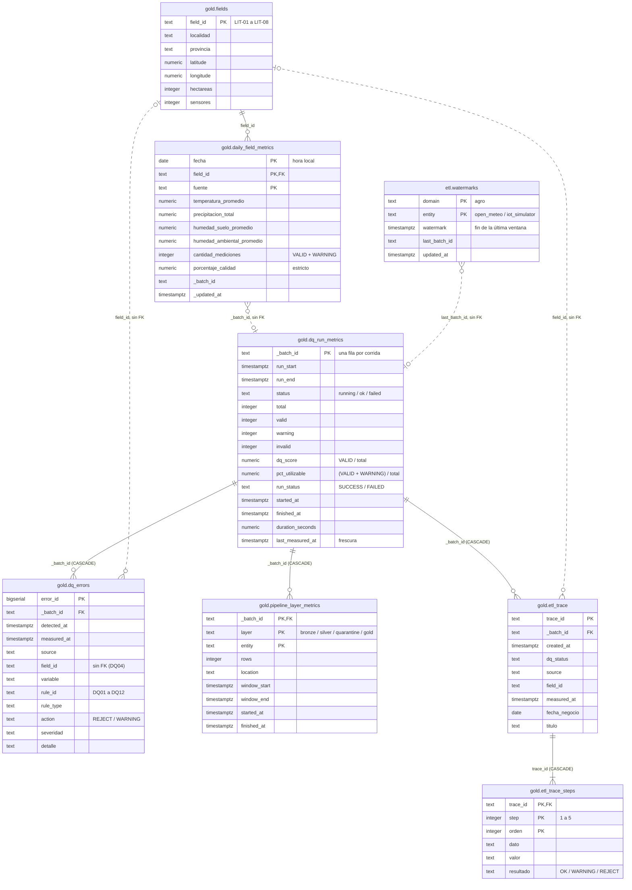

# Diagramas para el documento

Tres diagramas en Mermaid, armados para que entren legibles en una página A4 del documento: arquitectura general, esquema Medallion y base de datos. Todo lo que muestran sale del repositorio (`docker-compose.yml`, `src/pipeline.py`, `config/`, `sql/schema/01_schema.sql` y `grafana/`).

Para verlos: GitHub y VS Code (con la extensión *Markdown Preview Mermaid Support*) los dibujan solos. También se pueden pegar en https://mermaid.live.

## Cómo pasarlos al Word sin que se pierda la letra

1. **Exportá a imagen grande, nunca captura de pantalla.** En mermaid.live: *Actions → PNG* con *scale* 3, o *SVG* si el Word lo acepta (Word 365 inserta SVG y queda nítido a cualquier zoom). Con la consola: `npx -p @mermaid-js/mermaid-cli mmdc -i diagrama.mmd -o diagrama.png -s 3 -b white`.
2. **Insertalo al ancho de la página** (unos 16 cm de ancho útil en A4 con márgenes de 2,5 cm) y no lo achiques más. Si la letra queda menor a 8 pt, el diagrama tiene demasiadas cosas: partilo.
3. **Una idea por diagrama.** Por eso la base de datos está en dos versiones: una **compacta** (tablas, claves y relaciones) para el cuerpo del documento y una **completa** (todas las columnas) para el anexo.
4. **Orientación según la hoja.** `flowchart LR` (izquierda → derecha) aprovecha el ancho y `flowchart TB` (arriba → abajo), el alto. La arquitectura va en `TB` para una hoja vertical y el Medallion en `LR`, porque es una secuencia. Si un diagrama queda muy chato o muy alto, cambiá `LR` por `TB` (o al revés) en la primera línea. En los `erDiagram` no uses `direction LR`: algunas versiones de Mermaid (como la de mermaid.live hasta la 11.4) lo dibujan como dos tablas llamadas «direction» y «LR».
5. **Textos cortos en las cajas** y el detalle en la tabla o el párrafo que acompaña a la figura. Los saltos de línea dentro de una caja se escriben ` `.
6. **Pie de figura en el Word**, no dentro del diagrama: «Figura N. …».

---

## 1. Arquitectura general

Qué se ve: de dónde vienen los datos, qué código los procesa, dónde quedan, quién los consume y qué corre en cada contenedor de Docker Compose.

Notas para el texto:
- Todo corre con Docker Compose en una sola máquina, sin nube. Hay un contenedor scheduler por entorno (`scheduler-dev`, `scheduler-staging` y `scheduler-prod`). Los tres entornos usan el **mismo código**; cambian la base (`agro_<entorno>`), la carpeta del lake (`storage/<entorno>/`) y `config/environments/<entorno>.yaml`.
- Grafana entra con el usuario `dashboard`, que solo puede leer `gold` (RNF04).

---

## 2. Esquema Medallion

Qué se ve: qué contiene cada capa, qué la transforma en la siguiente y adónde van los rechazos.

Notas para el texto:
- **DQ Score estricto** = VALID / total × 100. **% utilizable** = (VALID + WARNING) / total × 100.
- Un WARNING se publica marcado; un rechazo en cualquier variable manda el registro completo a Quarantine (decisión D22).
- Reproceso: `python -m src.main --reprocess <batch_id>` regenera Silver, Quarantine y Gold desde Bronze.

---

## 3. Base de datos

### 3a. Versión compacta (para el cuerpo del documento)

Solo tablas, claves y relaciones. Línea continua: clave foránea real. Línea punteada: relación lógica sin clave foránea.

### 3b. Versión completa (para el anexo)

Bronze, Silver y Quarantine no aparecen: viven en el lake Parquet, no en PostgreSQL. La explicación de cada tabla está en [`modelo_datos.md`](modelo_datos.md).
