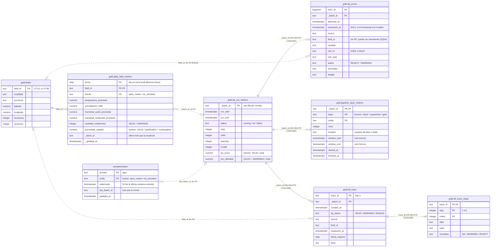

# Modelo de datos (PostgreSQL)

Diagrama de las tablas de `sql/schema/01_schema.sql`. Se repite igual en las tres bases (`agro_dev`, `agro_staging`, `agro_prod`). Bronze, Silver y Quarantine **no** están acá: viven en el lake Parquet (`storage/<entorno>/`).

- Línea continua: clave foránea real en la base.
- Línea punteada: relación lógica sin clave foránea, explicada en la etiqueta.

Imagen exportada: [`Diagrama de base de datos.png`](Diagrama%20de%20base%20de%20datos.png) (alta resolución) y [`modelo_datos.svg`](modelo_datos.svg) (vectorial).

## Qué guarda cada tabla

| Tabla | Para qué sirve | Quién la usa |
|---|---|---|
| `etl.watermarks` | Hasta dónde se leyó cada fuente (carga incremental) | La extracción (`run_bronze`) |
| `gold.fields` | Maestro de los 8 campos, sincronizado desde `config/fields.yaml` | Gold y los dashboards |
| `gold.daily_field_metrics` | Indicadores diarios por fecha, campo y fuente. **Es lo que consume el dashboard.** | Grafana |
| `gold.dq_run_metrics` | Una fila por corrida, con sus contadores, el DQ Score estricto y el % utilizable | Grafana, CI |
| `gold.dq_errors` | Cada hallazgo de las reglas (rechazos y warnings), con el registro que lo originó (RF08) | Grafana |
| `gold.pipeline_layer_metrics` | Qué hizo cada capa en cada lote: registros, duración y ventana (RNF02) | Dashboard «Flujo del ETL» |
| `gold.etl_trace` y `gold.etl_trace_steps` | Registros de muestra y lo que les pasó en cada uno de los 5 pasos | Dashboard «ETL paso a paso» |

Usuarios: `pipeline` lee y escribe `gold.*` y `etl.*`. `dashboard` solo lee `gold.*` (`sql/99_app_users.sh`).
